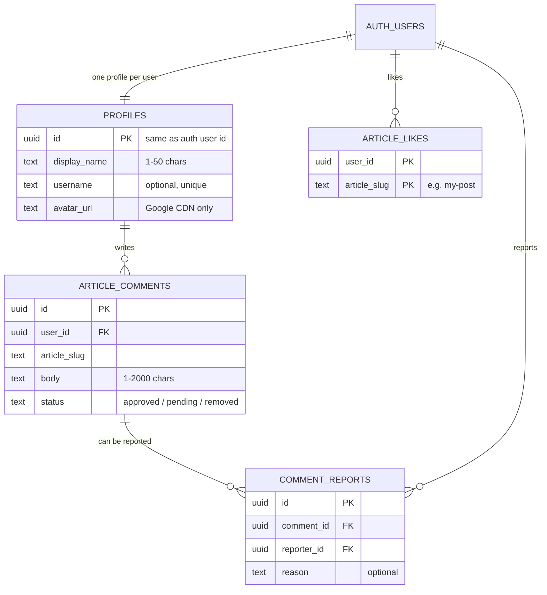
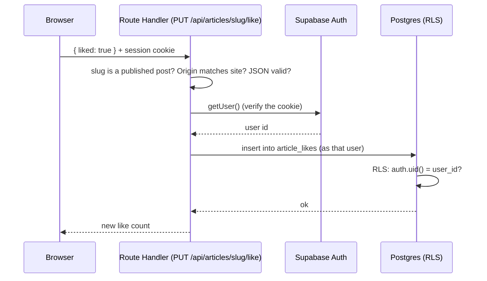

# Database and auth primer (for new developers)

A plain-language guide to the Supabase side of TechCoder. Read this first, then
use [auth-and-engagement.md](./auth-and-engagement.md) as the full reference
(routes, every policy, production setup).

## The big picture

- **Articles are not in the database.** They are `.mdx` files in Git.
- **The database only stores reader activity:** who the readers are, which
  articles they liked, what they commented, and which comments were reported.
- **Everything is optional.** If the two Supabase env vars are missing, the site
  still builds and every article is readable. Sign-in, likes and comments just
  stay hidden (`lib/supabase/config.ts`, `isSupabaseConfigured`).

## What Supabase gives us

| Piece | What it is | Where we use it |
| --- | --- | --- |
| **Supabase Auth** | Handles sign-up, sign-in (email + Google), password reset, and session cookies. Stores users in a built-in `auth.users` table that we never edit directly. | `/auth/*` pages, `components/auth/*` |
| **Postgres database** | A normal SQL database with our own tables in the `public` schema. | `supabase/migrations/*.sql` |
| **Row Level Security (RLS)** | Rules inside the database that decide which rows each user may read or change. | Policies in the first migration |
| **PostgREST API** | Supabase turns every table into an HTTP API automatically. The browser/server talks to it through `@supabase/supabase-js`. | `lib/supabase/client.ts`, `lib/supabase/server.ts` |

## Glossary

| Term | Meaning |
| --- | --- |
| **Migration** | A numbered `.sql` file describing one change to the database. They run in filename order and are never edited after being applied; add a new file instead. |
| **RLS (Row Level Security)** | "Even if you can call the API, you only see or change rows these rules allow." Every table here has it enabled. |
| **Policy** | One RLS rule, for example "a user can delete only their own like". |
| **JWT** | The signed token in the session cookie. It says who the user is (`auth.uid()`) and carries `app_metadata` (used for the moderator role). |
| **Publishable key** | The public Supabase key. It is safe in the browser **because RLS protects the data**. |
| **Service-role / secret key** | A key that bypasses RLS. **This app never uses it. Do not add it to `.env.local`, Vercel, or the code.** |
| **Trigger** | A function the database runs automatically when a row is inserted or updated (for example, creating a profile on sign-up). |
| **`security definer`** | A database function that runs with its owner's rights instead of the caller's. We use it sparingly (for example, a like count that doesn't reveal who liked). |
| **OAuth / PKCE** | The Google sign-in flow. The user goes to Google, comes back to `/auth/callback?code=...`, and we exchange the code for a session. |

## The tables



Things worth knowing:

- **`article_slug` is just text, not a foreign key.** There is no `articles`
  table because articles live in Git. The server checks the slug against
  published posts before every write.
- **`article_likes` has a composite primary key `(user_id, article_slug)`.**
  That makes a duplicate like impossible, so liking twice can't happen even if
  the code has a bug.
- **Comment `status`:** `approved` is visible; `pending` is hidden awaiting
  review (set automatically after 3 different reports); `removed` is hidden by
  a moderator.
- **`user_id` is never sent by the client.** It defaults to `auth.uid()` in the
  database, so a user can't post as someone else.

## The two migrations

Both are in `supabase/migrations/`:

1. `20261012090000_reader_accounts_likes_comments.sql` creates the four tables,
   indexes, rate-limit and auto-hide triggers, all RLS policies and explicit
   privileges. It also creates `profiles` automatically for each new user
   (`handle_new_user`).
2. `20261012120000_sync_profiles_from_auth_metadata.sql` keeps profiles in sync
   with the sign-in identity. On each Google sign-in the avatar refreshes, and
   the name is filled in only while it's still the placeholder `Reader`, so a
   name the reader chose is never overwritten. It also repairs older profiles.

## Following one request: liking an article



Two layers of checking matter: the Route Handler validates input (friendly
errors), and the database enforces the rules again (security). If you ever
change one layer, make sure the other still holds.

## Authentication in practice

- **Sign-up/sign-in:** forms in `components/auth/` call Supabase Auth.
  Sessions are stored in first-party cookies by `@supabase/ssr`.
- **Browser vs server clients:** use `lib/supabase/client.ts` in client
  components and `lib/supabase/server.ts` in Server Components and Route
  Handlers.
- **UI state is not security.** `AuthProvider` only decides what to show (the
  avatar, the comment box). The real permission checks are the Route Handlers
  and RLS.
- **`proxy.ts`** refreshes the session only for `/account` and `/auth/*`.
  Article pages stay static and never run it.
- **Redirects:** `?next=` goes through `safeNextPath()` so it can only point at
  pages on this site.

## Running it locally

There is no local Supabase and no Docker; you use a hosted project (ideally a
separate dev one).

1. Create a Supabase project and copy **Project URL** and **publishable key**
   (Dashboard, Project Settings, API Keys).
2. Copy `.env.example` to `.env.local` and fill in:
   ```
   NEXT_PUBLIC_SUPABASE_URL=
   NEXT_PUBLIC_SUPABASE_PUBLISHABLE_KEY=
   ```
3. Apply the migrations:
   ```bash
   npx supabase login
   npx supabase link --project-ref <ref>
   npx supabase db push
   ```
4. In the dashboard, add `http://localhost:3000/auth/callback**` under Auth,
   URL Configuration, Redirect URLs.
5. `npm run dev`, then try signing up at `/auth/sign-up`.

Restart the dev server after changing the env vars, because they are inlined
at build time.

## Making a database change

1. Create a **new** file in `supabase/migrations/` named
   `YYYYMMDDHHMMSS_short_description.sql`. Never edit an applied one.
2. Every new table must `enable row level security`, have explicit policies,
   and grant only the columns clients need.
3. Add checks to `supabase/tests/database/rls.test.sql`.
4. Apply with `npx supabase db push`, then run `npx supabase test db --linked`
   (use a dev project; the tests roll back).
5. Update [auth-and-engagement.md](./auth-and-engagement.md) and this page.

## Common problems

| Symptom | Likely cause and fix |
| --- | --- |
| No sign-in button, no likes or comments | The two `NEXT_PUBLIC_SUPABASE_*` vars are missing. Add them and restart. |
| Google button says "isn't available yet" | Google provider isn't enabled in Supabase (Auth, Providers). |
| After Google or email sign-in you land on an error | The callback URL isn't in **Redirect URLs**. Codespaces needs `https://*.app.github.dev/auth/callback**`. |
| Comment or like returns 401 | Not signed in, or the session expired. Sign in again. |
| Comment returns 429 | Rate limit: 3 comments per minute, 50 per day. Reports: 10 per hour. |
| Comment returns 404 | The slug isn't a published post (draft or typo). |
| Comment posts but doesn't show | Its `status` isn't `approved` (reported or removed). Check it in the SQL editor. |
| New moderator doesn't see "Remove" | The role is in the JWT: sign out and back in. |
| Query returns no rows though data exists | RLS is hiding them. That is usually correct; check the policy before "fixing" it. |

## Rules of thumb

- Never use or commit the secret/service-role key.
- Never trust the client: validate on the server and rely on RLS in the database.
- Never disable RLS to "make it work". Fix the policy.
- Keep articles in Git, not in the database.
